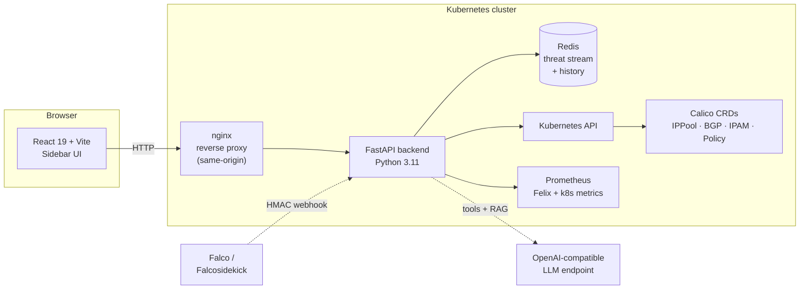

<div align="center">


**Your Calico cluster, finally answering questions.**

A purpose-built Kubernetes dashboard for Calico CNI diagnostics: policies, IPAM, BGP, topology, threats, and an AI assistant that reads live cluster state.

[](https://github.com/elyesbouzanbila-oss/C3-Dashboard/actions/workflows/ci.yml)
[](https://github.com/elyesbouzanbila-oss/C3-Dashboard/commits/main)
[](https://github.com/elyesbouzanbila-oss/C3-Dashboard/stargazers)
[](https://github.com/elyesbouzanbila-oss/C3-Dashboard/issues)
[](#license)

[](https://react.dev)
[](https://vite.dev)
[](https://fastapi.tiangolo.com)
[](https://www.tigera.io/project-calico/)
[](https://kubernetes.io)
[](https://docs.docker.com/compose/)

</div>

<!-- TODO: add a screenshot or short GIF here, e.g. . It is the single biggest improvement you can make to a README like this. -->

> General cluster monitoring (node CPU/memory, pod resources, storage) lives in **Grafana**. This project focuses on **Calico**.

## Contents

- [Why this exists](#why-this-exists)
- [Features](#features)
- [Architecture](#architecture)
- [Quick start](#quick-start)
- [Configuration](#configuration)
- [Security and RBAC](#security-and-rbac)
- [API reference](#api-reference)
- [Testing and CI](#testing-and-ci)
- [Project structure](#project-structure)
- [Extending](#extending)
- [Troubleshooting](#troubleshooting)
- [License](#license)

---

## Why this exists

Calico exposes a huge amount of data (CRDs, Felix metrics, IPAM blocks, BGP sessions, policy selectors), but the day-to-day tooling is mostly `kubectl get` and guesswork.

CNI Command Center turns that into a dashboard that answers the questions you actually ask during an incident:

| The question | Where the answer lives |
|:--|:--|
| *Is this pod actually protected by any policy?* | **Policy Coverage**: per-pod exposed vs. covered |
| *Which pods does this policy hit, rule by rule?* | **Policy Impact**: selection plus rule-by-rule breakdown |
| *Why is IPAM full? Who ate the blocks?* | **IPAM**: pool utilization and block allocation stats |
| *Are my BGP sessions actually up?* | **CNI Health / Topology**: per-node Felix + BIRD status, mesh graph |
| *What is Felix actually doing?* | **Felix metrics**: pulled from Prometheus |
| *Can pod A even talk to service B?* | **Diagnostics**: real connectivity test pods |
| *Did anything suspicious just happen?* | **Threats**: live Falco stream over WebSocket |
| *Who has cluster-admin, and who runs privileged?* | **Security**: RBAC audit and root/privileged pod detection |
| *Just tell me what's wrong.* | **AI Assistant**: LLM with live cluster tools and RAG grounding |

The UI is organized into four sidebar sections: **Overview** (Dashboard), **Network** (CNI Health, IPAM, Policies, Endpoints, Topology), **Security** (RBAC audit, privileged pods, Threats) and **Tools** (AI Assistant, Cluster Config). A **LIVE / DEMO** badge shows the current data source.

---

## Features

### Network

| Feature | What it does |
|:--|:--|
| **Dashboard** | One-glance overview: Calico agent health, BGP peers, IPAM utilization, policy counts, Felix performance. |
| **CNI Health** | Per-node Felix and BIRD/BGP agent cards with color-coded health, so the node that claims to be Ready but isn't stands out. |
| **IPAM** | IP pool utilization bars, block allocation statistics, pool definition tables. |
| **Policies** | Searchable, filterable table of Calico `NetworkPolicy` and `GlobalNetworkPolicy` with Allow/Deny badges. A sub-view shows **Policy Coverage** (per-pod exposed/covered detection with namespace summaries). |
| **Endpoints** | Per-pod Calico workload endpoint state: selecting policies, exposed/covered status, interface status, ingress/egress rule digests. |
| **Policy Impact** | Pick a policy and see the exact pods it selects plus a rule-by-rule breakdown (action, protocol, ports, peer selector, matched pods). |
| **Topology** | Interactive Cytoscape.js node-to-node BGP mesh and pod overlay graph. |
| **Diagnostics** | On-demand pod-to-pod and pod-to-service connectivity tests using ephemeral test pods. |

### Security

| Feature | What it does |
|:--|:--|
| **Threats** | Real-time, network-scoped threat stream over WebSocket, fed by HMAC-signed **Falco** webhooks, with recent history kept in Redis. |
| **Security** | RBAC binding audit and privileged / root-container pod detection. |

### Tools

| Feature | What it does |
|:--|:--|
| **AI Assistant** | Chat with an LLM that fetches live cluster data on demand and is grounded with retrieved knowledge. |
| **Cluster Config** | Super-user-protected management of IP pools, BGP peers, namespaces, services, configmaps, secrets, deployments and node cordoning, with an audit log of every write. |

<details>
<summary><b>Deep dive: what "Policy Coverage" computes</b></summary>

<br/>

The backend parses Calico selector syntax and evaluates it against pod labels, with correct namespace scoping:

- `GlobalNetworkPolicy` matches pods across **all** namespaces.
- `NetworkPolicy` matches only pods in **its own** namespace.
- An **empty selector means `all()`**, so it selects every pod in scope. A `default-deny` is not a no-op.

For each pod you get whether it is exposed, which policies select it, and warnings for unsupported selector expressions instead of silent false negatives.

</details>

<details>
<summary><b>Deep dive: how the AI assistant stays grounded</b></summary>

<br/>

1. **Tools, not guesses**: the model can call backend functions that read live cluster state.
2. **RAG grounding**: retrieved context is injected so answers reference real policies and pods.
3. **Input guardrails**: client-supplied history is untrusted. Only `user`/`assistant` turns are kept (no `system` prompt injection), capped at 20 messages of 8k characters each.
4. **Rate limited**: 20 requests/min/IP.

</details>

---

## Architecture



**Stack:** React 19, Vite, TypeScript and Cytoscape.js on the frontend; FastAPI (Python 3.11), Pydantic and slowapi on the backend; Redis for the threat stream; nginx as the same-origin reverse proxy; Prometheus, Falco and any OpenAI-compatible LLM endpoint as optional integrations.

Node/pod resource graphs, storage and long-term time series are handled by **Grafana** via `kube-prometheus-stack`, deployed separately. For deeper Felix charts, import Grafana dashboard [ID 12175](https://grafana.com/grafana/dashboards/12175-calico-felix/).

> [!IMPORTANT]
> **Mock data is opt-in.** With `K8S_MODE=mock` you get fabricated demo data and a **DEMO** badge in the UI.
> Without it, unreachable endpoints return **error envelopes, never fake data**. A real cluster never receives mock responses.

---

## Quick start

### Prerequisites

| Need | Version / note |
|:--|:--|
| Docker + Compose | any recent version |
| Node.js | `24.15.x` or `>=26.0.0` (frontend build/test) <!-- TODO: CI currently runs Node 22; confirm which versions are actually supported --> |
| Kubernetes cluster | local, cloud, or on-prem (not needed for demo mode) |
| `kubectl` | configured, or a service-account token with cluster-wide read |
| Prometheus | *optional*: enables time-series charts |
| Falco + Falcosidekick | *optional*: enables live threat ingestion |

### Option A: try it without a cluster (demo mode)

Set these in your backend `.env` (see [Configuration](#configuration)):

```env
API_KEY=<any value, e.g. from: openssl rand -base64 32>
K8S_MODE=mock
```

Then start the stack:

```bash
docker compose up --build
```

### Option B: run against a real cluster

Use `K8S_MODE=kubeconfig` (default; `docker-compose.yml` mounts your kubeconfig into the backend container), set `API_KEY`, then:

```bash
docker compose up --build
```

| Service | URL |
|:--|:--|
| Frontend | http://localhost:5173 |
| Backend | http://localhost:8000 |
| Redis | localhost:6379 |

### Option C: deploy into a cluster

```bash
kubectl apply -k k8s/
```

This creates the `k8s-dashboard` namespace and deploys the frontend, backend and Redis. Then find the frontend service:

```bash
kubectl get svc -n k8s-dashboard dashboard-frontend
# visit https://<any-node-ip>:<https-node-port>
```

> [!NOTE]
> The backend (`dashboard-backend`) is **ClusterIP only**: it is reachable exclusively through the nginx reverse proxy in the frontend pod. External API calls must go through the frontend's NodePort.

Secrets (`k8s/secret*.yaml`) are generated locally and gitignored. `deploy.sh` is a helper for deploying to a kind cluster.

<details>
<summary><b>Building and loading images for kind / minikube</b></summary>

<br/>

Deployments use `imagePullPolicy: IfNotPresent`, so a locally built image is used if present.

```bash
docker compose build
# or individually:
docker build -t dashboard-backend:latest ./backend
docker build -t dashboard-frontend:latest ./frontend
```

```bash
# kind
kind load docker-image dashboard-backend:latest dashboard-frontend:latest

# minikube
minikube image load dashboard-backend:latest
minikube image load dashboard-frontend:latest
```

</details>

<details>
<summary><b>Network policies and coverage (read before applying)</b></summary>

<br/>

The `k8s/networkpolicy-*.yaml` files ship **Calico NetworkPolicy CRDs**, so in-cluster enforcement *and* the dashboard's Policy Coverage / Endpoints / Impact views (which read Calico CRDs only) see the same policies.

```bash
# Dashboard policies (namespace k8s-dashboard)
kubectl apply -f k8s/networkpolicy-backend.yaml \
              -f k8s/networkpolicy-redis.yaml \
              -f k8s/networkpolicy-frontend.yaml -n k8s-dashboard

# Falco stack policies (namespace falco), excluded from kustomization on purpose
kubectl apply -f k8s/networkpolicy-falco.yaml
```

> [!WARNING]
> **API version matters.** These policies declare `apiVersion: crd.projectcalico.org/v1`.
> Clusters installed via the **Tigera operator (Calico v3.27+)** serve only that group; older
> manifest-based installs serve `projectcalico.org/v3`. Applying the wrong one fails with
> `no matches for kind "NetworkPolicy"`.
>
> Check with `kubectl api-resources | grep -i calico` and match the served version.

</details>

<details>
<summary><b>Local development (backend and frontend separately)</b></summary>

<br/>

```bash
# backend
cd backend
pip install -r requirements.txt
python -m uvicorn main:app --reload --no-proxy-headers

# frontend
cd frontend
npm install
npm run dev
```

`--no-proxy-headers` stops uvicorn from rewriting the client address from a spoofed `X-Forwarded-For`, so rate limits key on the real client IP.

</details>

---

## Configuration

### Cluster connection modes

Set `K8S_MODE` to one of:

| Mode | Use when | Extra settings |
|:--|:--|:--|
| `kubeconfig` | Local dev (default) | None. `docker-compose.yml` mounts your kubeconfig. |
| `token` | Remote clusters | `K8S_SERVER=https://<cluster>:6443`, `K8S_TOKEN=<service-account-token>` |
| `incluster` | Deployed inside Kubernetes | None |
| `mock` | Demo, no cluster | Serves fabricated data from `models/mock_data.py` and shows a **DEMO** badge. Opt-in only. |

### Backend environment variables (`.env`)

| Variable | Required | Default / example | Purpose |
|:--|:--:|:--|:--|
| `API_KEY` | **Yes** | none (generate with `openssl rand -base64 32`) | API key for protected backend endpoints |
| `K8S_MODE` | No | `kubeconfig` | See modes above |
| `K8S_SERVER`, `K8S_TOKEN` | token mode | | Remote cluster endpoint and service-account token |
| `FRONTEND_URL` | No | `http://localhost:5173` | Allowed frontend origin |
| `REDIS_URL` | No | `redis://redis:6379/0` | Threat stream and history |
| `REDIS_PASSWORD` | No | | Must match the Redis deployment |
| `PROMETHEUS_URL` | No | `http://prometheus-k8s.monitoring.svc:9090` | Enables time-series charts |
| `FALCO_WEBHOOK_SECRET` | No | | HMAC secret for the Falco webhook (see Security) |
| `SUPER_USER_PASSWORD` | No | | Protects Cluster Config writes (see warning below) |
| `AI_ENABLED` | No | `true` | Toggle the AI assistant |
| `AI_API_KEY` | No | | Key for the LLM provider |
| `AI_BASE_URL` | No | `https://api.groq.com/openai/v1` | Any OpenAI-compatible endpoint |
| `AI_MODEL` | No | `llama-3.3-70b-versatile` | Model name |

### Frontend environment variables (`.env.local`)

```env
VITE_API_URL=http://localhost:8000
```

No API key is needed in the browser: the frontend talks to the backend through the nginx reverse proxy (same-origin).

---

## Security and RBAC

> [!WARNING]
> **Before exposing this anywhere beyond your laptop:**
> - Set a strong `API_KEY`.
> - Set `SUPER_USER_PASSWORD`. When it is empty, Cluster Config writes are allowed **without a password** (they are still audited).
> - Put the backend behind an authenticating reverse proxy (nginx + OIDC/mTLS, Istio authz policy, or `oauth2-proxy`). Locally, nginx only provides same-origin isolation.
> - Set `FALCO_WEBHOOK_SECRET` so the Falco webhook (`/api/threats/falco`) is authenticated with HMAC-SHA256 (header `X-Falco-Signature`).
> - Remember that super-user sessions can read secret **values** and write to the cluster.

### Rate limits (`slowapi`)

| Endpoint | Limit |
|:--|:--|
| Falco webhook | 600 POST/min/IP |
| Threat history | 30/min/IP |
| Connectivity diagnostics | 10/min/IP |
| Super-user auth | 5/min/IP |
| AI chat | 20/min/IP |

Limits are keyed on the **real client IP** (`X-Real-IP` from nginx, or the socket peer), never the client-writable `X-Forwarded-For`.

### ClusterRole permissions

Defined in [`k8s/clusterrole.yaml`](k8s/clusterrole.yaml).

| API group | Resources | Verbs | Purpose |
|:--|:--|:--|:--|
| core | `pods`, `services`, `nodes`, `endpoints`, `namespaces` | get, list, watch | Pod discovery, topology, diagnostics |
| `rbac.authorization.k8s.io` | `clusterrolebindings`, `rolebindings`, `clusterroles`, `roles` | get, list | RBAC audit |
| `metrics.k8s.io` | `pods`, `nodes` | get, list, watch | Resource panels (if metrics-server is present) |
| `storage.k8s.io` | `storageclasses` | get, list | Storage class discovery |
| core | `persistentvolumes`, `persistentvolumeclaims` | get, list, watch | PVC/PV overview |
| `networking.k8s.io` | `networkpolicies` | get, list | K8s NetworkPolicy discovery |
| `crd.projectcalico.org` | `ippools`, `ipamblocks`, `ipamconfigs`, `bgppeers`, `bgpconfigurations`, `felixconfigurations`, `networkpolicies`, `globalnetworkpolicies`, `hostendpoints`, `clusterinformations` | get, list, watch | Calico diagnostics: IPAM, BGP, policies, Felix |
| core | `pods` | create, delete | Ephemeral connectivity test pods |
| core | `pods/log` | get | Read diagnostic pod output |

> [!TIP]
> Only `pods create/delete` and `pods/log get` are write permissions. They are cluster-wide for convenience; narrow them to one namespace with a `Role` + `RoleBinding` if you prefer.

Verify the service account's permissions:

```bash
kubectl auth can-i list ippools --as=system:serviceaccount:k8s-dashboard:dashboard-sa
kubectl auth can-i create pods --as=system:serviceaccount:k8s-dashboard:dashboard-sa
kubectl auth can-i get pods/log --as=system:serviceaccount:k8s-dashboard:dashboard-sa
```

### Audit trail

Every Cluster Config write is logged with actor, action, target and result. Read it at `/api/config/audit` (requires `X-Super-User-Token`).

---

## API reference

<details open>
<summary><b>Health and demo</b></summary>

<br/>

| Endpoint | Method | Description | Rate limit |
|:--|:--|:--|:--|
| `/`, `/healthz`, `/readyz` | GET | Liveness and readiness probes | none |
| `/mock/pods`, `/mock/topology`, `/mock/rbac`, `/mock/privileged` | GET | Demo data, **only in `K8S_MODE=mock`** | none |

</details>

<details>
<summary><b>Network</b></summary>

<br/>

| Endpoint | Method | Description | Rate limit |
|:--|:--|:--|:--|
| `/api/network/pods` | GET | All pods across namespaces | none |
| `/api/network/topology` | GET | Cluster topology graph (nodes and edges) | none |

</details>

<details>
<summary><b>CNI / Calico</b></summary>

<br/>

| Endpoint | Method | Description | Rate limit |
|:--|:--|:--|:--|
| `/api/cni/nodes` | GET | Per-node Calico agent status | none |
| `/api/cni/bgp-peers` | GET | BGP peers and session state | none |
| `/api/cni/ippools` | GET | IP pool definitions | none |
| `/api/cni/ipam/utilization` | GET | Allocated vs. free IPs per pool | none |
| `/api/cni/policies` | GET | Calico NetworkPolicy and GlobalNetworkPolicy | none |
| `/api/cni/policies/coverage` | GET | Per-pod coverage (exposed vs. covered, unsupported-selector warnings) | none |
| `/api/cni/policy-matrix` | GET | Workload endpoints and policy impact (selecting policies, rule breakdown) | none |
| `/api/cni/topology` | GET | BGP mesh and overlay topology | none |
| `/api/cni/metrics/felix` | GET | Felix performance counters | none |
| `/api/cni/diagnostics/connectivity` | POST | Connectivity test (requires `X-API-Key`) | 10/min |

</details>

<details>
<summary><b>Threats and security</b></summary>

<br/>

| Endpoint | Method | Description | Rate limit |
|:--|:--|:--|:--|
| `/api/threats/falco` | POST | Falco webhook: ingest events (HMAC-signed) | 600/min |
| `/api/threats/history` | GET | Recent events (Redis) | 30/min |
| `/api/threats/ws/threats` | WebSocket | Real-time threat stream | none |
| `/api/security/rbac` | GET | RBAC bindings audit | none |
| `/api/security/privileged-pods` | GET | Privileged / root containers | none |

</details>

<details>
<summary><b>AI</b></summary>

<br/>

| Endpoint | Method | Description | Rate limit |
|:--|:--|:--|:--|
| `/api/ai/status` | GET | Assistant availability | none |
| `/api/ai/chat` | POST | Chat with the cluster-aware assistant | 20/min |

</details>

<details>
<summary><b>Cluster config (super-user)</b></summary>

<br/>

All write endpoints and secret-value reads require `X-Super-User-Token`.

| Endpoint | Method | Description | Rate limit |
|:--|:--|:--|:--|
| `/api/config/auth` | POST | Mint a super-user session token (15-minute TTL) | 5/min |
| `/api/config/...` | GET | Read ippools, bgppeers, namespaces, services, configmaps, deployments, nodes, settings; secret **names/keys**; secret **values** via `/secrets/{ns}/{name}` (token required) | none |
| `/api/config/...` | POST/PUT/DELETE | CRUD on the above, image/scale/restart, node cordon/uncordon (all audited) | none |
| `/api/config/audit` | GET | Write audit log | none |

</details>

---

## Testing and CI

CI (`.github/workflows/ci.yml`) runs five jobs on every push to `main` / `feat/*` and every pull request:

| Job | Tool |
|:--|:--|
| `backend-tests` | pytest (Python 3.11) |
| `frontend-tests` | vitest (Node 22) |
| `frontend-lint` | eslint |
| `frontend-typecheck` | `tsc --noEmit` |
| `frontend-build` | `vite build` |

Run locally:

```bash
# backend
cd backend && PYTHONPATH=. python -m pytest tests/ -v

# frontend
cd frontend && npm ci && npm test
```

---

## Project structure

<details>
<summary><b>Expand the full tree</b></summary>

<br/>

```
.
├── docker-compose.yml             # frontend + backend + redis
├── deploy.sh                      # kind-cluster deploy helper
├── .github/workflows/ci.yml       # CI: tests, lint, typecheck, build
├── backend/
│   ├── main.py                    # FastAPI entry point (+ /healthz, /readyz)
│   ├── config.py                  # Settings via Pydantic (K8S_MODE, AI, secrets)
│   ├── dependencies.py            # K8s client dependency + mock-mode gate
│   ├── Dockerfile / requirements.txt
│   ├── connection/                # K8s client factory (kubeconfig/token/in-cluster)
│   ├── models/
│   │   ├── cni_models.py          # CNI Pydantic schemas
│   │   ├── mock_data.py           # Opt-in demo data
│   │   ├── network.py             # Pod/topology models
│   │   └── threat.py              # Falco event schema
│   ├── routers/
│   │   ├── cni.py                 # Calico CRDs, IPAM, BGP, Felix, coverage, matrix
│   │   ├── network.py             # Pod discovery, topology
│   │   ├── threats.py             # Falco webhook + WebSocket + history
│   │   ├── security.py            # RBAC audit + privileged pods
│   │   ├── ai.py                  # AI chat + status
│   │   ├── config.py              # Cluster CRUD (super-user protected)
│   │   └── mock.py                # /mock/* demo endpoints
│   ├── services/
│   │   ├── calico_service.py      # Calico CRD access
│   │   ├── network_service.py     # Pod & service discovery
│   │   ├── prometheus_service.py  # PromQL proxy
│   │   ├── felix_metrics_service.py
│   │   ├── threat_service.py      # Redis pub/sub for Falco events
│   │   ├── security_service.py    # RBAC / privileged-pod queries
│   │   ├── ai_service.py          # LLM chat with cluster tools
│   │   ├── config_service.py      # CRUD ops
│   │   ├── auth_service.py        # Super-user session tokens
│   │   ├── audit_service.py       # Write-op audit log
│   │   ├── logging_service.py
│   │   └── utils.py               # Calico selector parser + coverage engine
│   └── tests/                     # pytest suites (routers, services, utils, models)
├── frontend/
│   ├── src/
│   │   ├── App.tsx                # Sidebar nav (Overview/Network/Security/Tools)
│   │   ├── App.css / index.css    # Theme + styles
│   │   ├── config.ts / types.ts / utils.ts
│   │   ├── Topology.tsx           # Cytoscape.js graph
│   │   ├── context/DashboardContext.tsx  # Shared fetching + WS state
│   │   └── components/            # One panel per feature (Dashboard, CniHealth,
│   │                              # Ipam, PolicyInspector, PolicyCoverage,
│   │                              # WorkloadEndpoints, PolicyImpact, CniTopology,
│   │                              # Diagnostics, Threat, Security, Chat,
│   │                              # ClusterConfig, SuperUserModal, shared UI)
│   ├── nginx.conf                 # SPA reverse proxy
│   ├── docker-entrypoint.sh       # Runtime env injection
│   ├── Dockerfile                 # Multi-stage (Vite → nginx)
│   └── package.json
├── k8s/                           # kustomization-driven manifests
│   ├── kustomization.yaml         # `kubectl apply -k k8s/`
│   ├── namespace/sa/clusterrole/clusterrolebinding
│   ├── deploy-*.yaml, svc-*.yaml, pvc-redis.yaml
│   ├── networkpolicy-{backend,redis,frontend,falco}.yaml
│   ├── cert-issuer.yaml           # applied conditionally by deploy.sh
│   ├── gen-tls-secret.sh
│   └── secret*.yaml               # generated locally (gitignored)
└── README.md
```

</details>

---

## Extending

| I want to... | Do this |
|:--|:--|
| **Add a CNI panel** | Service function in `backend/services/calico_service.py`, route in `backend/routers/cni.py`, React component in `frontend/src/components/` |
| **Add a Prometheus chart** | PromQL function in `backend/services/prometheus_service.py`, chart card in the relevant component |
| **Add a data source** | New service and router in the backend (the K8s client is injected via a FastAPI dependency) |
| **Add demo data** | Extend `models/mock_data.py`, served **only** under `K8S_MODE=mock` |

---

## Troubleshooting

| Symptom | Likely cause and fix |
|:--|:--|
| `no matches for kind "NetworkPolicy"` when applying policies | Wrong Calico API group. Check `kubectl api-resources \| grep -i calico` and use `crd.projectcalico.org/v1` or `projectcalico.org/v3` accordingly. |
| Backend not reachable from outside the cluster | It is ClusterIP only by design. Go through the frontend's NodePort. |
| **DEMO** badge showing against a real cluster | `K8S_MODE=mock` is set. Switch to `kubeconfig`, `token` or `incluster`. |
| Endpoints return error envelopes | The backend can't reach the Kubernetes API, Calico CRDs or Prometheus. Check `K8S_MODE`, credentials, RBAC (`kubectl auth can-i ...`) and `PROMETHEUS_URL`. |
| No live threats | Confirm Falcosidekick posts to `/api/threats/falco` with a matching `X-Falco-Signature` / `FALCO_WEBHOOK_SECRET`, and that Redis is reachable. |
| Rate limits hit unexpectedly in local dev | Run uvicorn with `--no-proxy-headers` so limits key on the real client IP. |

---

## License

Internal project. <!-- TODO: the repo's badges suggest it is public on GitHub; add a LICENSE file (e.g. MIT) or state clearly that it is proprietary. -->

<div align="center">

<sub>Built for clusters where "it works on my namespace" isn't good enough.</sub>

</div>