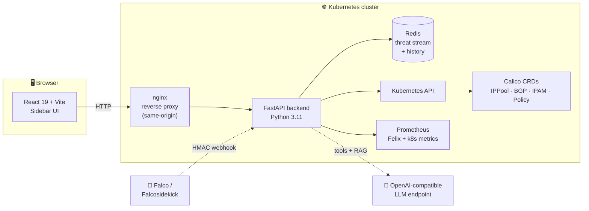

<div align="center">

# ⚡ CNI Command Center

### *Your Calico cluster, finally answering questions.*

**A purpose-built Kubernetes command center for Calico CNI diagnostics — policies, IPAM, BGP, topology, threats, and an AI that actually reads your cluster.**

[](https://github.com/elyesbouzanbila-oss/C3-Dashboard/actions/workflows/ci.yml)
[](https://github.com/elyesbouzanbila-oss/C3-Dashboard/commits/main)
[](https://github.com/elyesbouzanbila-oss/C3-Dashboard/stargazers)
[](https://github.com/elyesbouzanbila-oss/C3-Dashboard/issues)

[](https://react.dev)
[](https://vite.dev)
[](https://fastapi.tiangolo.com)
[](https://www.tigera.io/project-calico/)
[](https://kubernetes.io)
[](https://docs.docker.com/compose/)
[](#-license)

<br/>

```
  ██████╗███╗   ██╗██╗    ██████╗ ██████╗ ███╗   ███╗███╗   ███╗ █████╗ ███╗   ██╗██████╗
 ██╔════╝████╗  ██║██║   ██╔════╝██╔═══██╗████╗ ████║████╗ ████║██╔══██╗████╗  ██║██╔══██╗
 ██║     ██╔██╗ ██║██║   ██║     ██║   ██║██╔████╔██║██╔████╔██║███████║██╔██╗ ██║██║  ██║
 ██║     ██║╚██╗██║██║   ██║     ██║   ██║██║╚██╔╝██║██║╚██╔╝██║██╔══██║██║╚██╗██║██║  ██║
 ╚██████╗██║ ╚████║██║   ╚██████╗╚██████╔╝██║ ╚═╝ ██║██║ ╚═╝ ██║██║  ██║██║ ╚████║██████╔╝
  ╚═════╝╚═╝  ╚═══╝╚═╝    ╚═════╝ ╚═════╝ ╚═╝     ╚═╝╚═╝     ╚═╝╚═╝  ╚═╝╚═╝  ╚═══╝╚═════╝
                         ██████╗███████╗███╗   ██╗████████╗███████╗██████╗
                        ██╔════╝██╔════╝████╗  ██║╚══██╔══╝██╔════╝██╔══██╗
                        ██║     █████╗  ██╔██╗ ██║   ██║   █████╗  ██████╔╝
                        ██║     ██╔══╝  ██║╚██╗██║   ██║   ██╔══╝  ██╔══██╗
                        ╚██████╗███████╗██║ ╚████║   ██║   ███████╗██║  ██║
                         ╚═════╝╚══════╝╚═╝  ╚═══╝   ╚═╝   ╚══════╝╚═╝  ╚═╝
```

<sub>General cluster monitoring (node CPU/mem, pod resources, storage) lives in **Grafana**. This thing does **Calico**.</sub>

</div>

---

<div align="center">

### 🧭 Jump to

[✨ What is this](#-what-is-this) ·
[🚀 Feature tour](#-feature-tour) ·
[🏗️ Architecture](#️-architecture) ·
[⚡ Quick start](#-quick-start) ·
[⚙️ Configuration](#️-configuration) ·
[🔐 Security](#-security--rbac) ·
[🧪 Testing](#-testing--ci) ·
[🗺️ Structure](#️-project-structure) ·
[🧩 Extending](#-extending)

</div>

---

## ✨ What is this

> Calico gives you an incredible amount of data — CRDs, Felix metrics, IPAM blocks, BGP sessions, policy selectors.
> It also gives you `kubectl get` and vibes.

**CNI Command Center** turns that pile of CRDs into a dashboard that answers the questions you actually ask at 2 AM:

| The question | Where the answer lives |
|---|---|
| 🧨 *"Is this pod actually protected by any policy?"* | **Policy Coverage** — per-pod exposed vs. covered |
| 🎯 *"Which pods does this policy hit, rule by rule?"* | **Policy Impact** — selection + rule-by-rule breakdown |
| 📦 *"Why is IPAM full? Who ate the blocks?"* | **IPAM** — pool utilization, block allocation stats |
| 🕸️ *"Are my BGP sessions actually up?"* | **CNI Health / Topology** — per-node Felix + BIRD status, mesh graph |
| 🐦 *"What is Felix actually doing?"* | **Felix metrics** — pulled from Prometheus |
| 🔌 *"Can pod A even talk to service B?"* | **Diagnostics** — real connectivity test pods |
| 🚨 *"Did anything sketchy just happen?"* | **Threats** — live Falco stream over WebSocket |
| 🔑 *"Who has cluster-admin, and who runs privileged?"* | **Security** — RBAC audit + root/privileged pod detection |
| 🤖 *"Just tell me what's wrong."* | **AI Assistant** — LLM with live cluster tools + RAG grounding |

<br/>

<div align="center">

```
┌──────────────────────────────────────────────────────────────────────────┐
│  OVERVIEW   │   NETWORK   │   SECURITY   │   TOOLS                       │
│  Dashboard  │   CNI Health│   RBAC audit │   AI Assistant                │
│             │   IPAM      │   Privileged │   Cluster Config              │
│             │   Policies  │              │                               │
│             │   Endpoints │              │   [ LIVE / DEMO ]   [ Export ]│
└──────────────────────────────────────────────────────────────────────────┘
```

</div>

---

## 🚀 Feature tour

<table>
<tr>
<td width="50%" valign="top">

### 📊 Dashboard
The overview that isn't a wall of graphs: Calico agent health, BGP peers, IPAM utilization, policy counts, Felix performance — all in one glance.

### 🩺 CNI Health
Per-node **Felix** and **BIRD/BGP** agent cards with color-coded health indicators. Instantly spot the one node that's lying about being Ready.

### 📦 IPAM
IP pool utilization bars, block allocation statistics, pool definition tables. Find out exactly where the addresses went.

### 🛡️ Policies
Searchable / filterable table of Calico `NetworkPolicy` + `GlobalNetworkPolicy` with **Allow / Deny** badges.
Sub-view toggle for **Policy Coverage**: per-pod exposed/covered detection with namespace summaries.

</td>
<td width="50%" valign="top">

### 🔌 Endpoints
Per-pod Calico workload endpoint state: selecting policies, exposed/covered status, interface status, and per-direction ingress/egress rule digests.

### 🎯 Policy Impact
Pick a policy → see the exact pods it selects **and** a rule-by-rule breakdown: action, protocol, ports, peer selector, matched pods.

### 🕸️ Topology
Interactive **Cytoscape.js** node-to-node BGP mesh plus pod overlay graph. Zoom, drag, panic.

### 🧪 Diagnostics
On-demand pod-to-pod / pod-to-service connectivity runner using ephemeral test pods.

</td>
</tr>
<tr>
<td width="50%" valign="top">

### 🚨 Threats
Real-time, network-scoped threat streaming over **WebSocket**, fed by **Falco** webhooks (HMAC-signed), with recent-event history in Redis.

### 🔑 Security
RBAC binding audit + privileged / root-container pod detection. Know your blast radius before someone else does.

</td>
<td width="50%" valign="top">

### 🤖 AI Assistant
Chat with an LLM that **fetches live cluster data on demand** and is grounded with retrieved knowledge — not hallucinated YAML.

### ⚙️ Cluster Config
Super-user-protected management of IP pools, BGP peers, namespaces, services, configmaps, secrets, deployments, and node cordoning — with a full audit log of every write.

</td>
</tr>
</table>

<details>
<summary><b>🔍 Deep dive — what "Policy Coverage" actually computes</b></summary>

<br/>

The backend parses Calico selector syntax and evaluates it against pod labels, with correct namespace scoping:

- `GlobalNetworkPolicy` → matches pods across **all** namespaces
- `NetworkPolicy` → only pods in **its own** namespace
- **Empty selector = `all()`** → selects every pod in scope (a `default-deny` is *not* a no-op)

For each pod you get: whether it's exposed, which policies select it, and warnings for unsupported selector expressions rather than silent false-negatives.

</details>

<details>
<summary><b>🔍 Deep dive — how the AI assistant stays honest</b></summary>

<br/>

1. **Tools, not vibes** — the model can call backend functions that read live cluster state.
2. **RAG grounding** — retrieved context is injected so answers reference real policies/pods.
3. **Input guardrails** — client-supplied history is untrusted: only `user`/`assistant` turns are kept (no `system` prompt injection), capped at 20 messages × 8k chars.
4. **Rate limited** — 20 req/min/IP.

</details>

---

## 🏗️ Architecture



<div align="center">
<sub>📊 Node/pod resource graphs, storage, long-term time series → <b>Grafana</b> via <code>kube-prometheus-stack</code>, deployed separately.<br/>
Deeper Felix charts? Import Grafana dashboard <a href="https://grafana.com/grafana/dashboards/12175-calico-felix/">ID 12175</a>.</sub>
</div>

<br/>

> [!IMPORTANT]
> **Mock data is opt-in.** With `K8S_MODE=mock` you get fabricated demo data and a **DEMO** badge in the UI.
> Without it, unreachable endpoints return **error envelopes — never fake data.** A real cluster never receives mock responses.

---

## ⚡ Quick start

### 🐳 The one-liner path

```bash
docker compose up --build
```

<div align="center">

**→ [http://localhost:5173](http://localhost:5173) ←**

| Service | URL |
|:--|:--|
| 🖥️ Frontend | http://localhost:5173 |
| 🔌 Backend | http://localhost:8000 |
| 🧠 Redis | localhost:6379 |

</div>

### 📋 Prerequisites

| Need | Version / note |
|:--|:--|
| Docker + Compose | any recent |
| Node.js | `24.15.x` or `>=26.0.0` (frontend build/test) |
| Kubernetes cluster | local, cloud, or on-prem |
| `kubectl` | configured, or a SA token with cluster-wide read |
| Prometheus | *optional* — enables time-series charts |
| Falco + Falcosidekick | *optional* — enables live threat ingestion |

### ☸️ Deploy into a cluster

```bash
kubectl apply -k k8s/
```

Creates namespace `k8s-dashboard` and deploys frontend, backend, and Redis.

```bash
kubectl get svc -n k8s-dashboard dashboard-frontend
# then visit https://<any-node-ip>:<https-node-port>
```

> [!NOTE]
> The backend (`dashboard-backend`) is **ClusterIP only** — reachable exclusively through the nginx reverse proxy in the frontend pod. External API calls must go through the frontend's NodePort.

<details>
<summary><b>🏗️ Building & loading images for kind / minikube</b></summary>

<br/>

Deployments use `imagePullPolicy: IfNotPresent`, so a locally built image is used if present.

```bash
docker compose build
# or individually:
docker build -t dashboard-backend:latest ./backend
docker build -t dashboard-frontend:latest ./frontend
```

```bash
# kind
kind load docker-image dashboard-backend:latest dashboard-frontend:latest

# minikube
minikube image load dashboard-backend:latest
minikube image load dashboard-frontend:latest
```

</details>

<details>
<summary><b>🛡️ Network policies & coverage (read this before applying)</b></summary>

<br/>

The `k8s/networkpolicy-*.yaml` files ship **Calico NetworkPolicy CRDs**, so in-cluster enforcement *and* the dashboard's Policy Coverage / Endpoints / Impact views (which read Calico CRDs only) see the same policies.

```bash
# Dashboard policies (namespace k8s-dashboard)
kubectl apply -f k8s/networkpolicy-backend.yaml -f k8s/networkpolicy-redis.yaml -f k8s/networkpolicy-frontend.yaml -n k8s-dashboard

# Falco stack policies (namespace falco) — excluded from kustomization on purpose
kubectl apply -f k8s/networkpolicy-falco.yaml
```

> [!WARNING]
> **API version matters.** These policies declare `apiVersion: crd.projectcalico.org/v1`.
> Clusters installed via the **Tigera operator (Calico v3.27+)** serve only that group; older
> manifest-based installs serve `projectcalico.org/v3`. Applying the wrong one fails with
> `no matches for kind "NetworkPolicy"`.
>
> Check with `kubectl api-resources | grep -i calico` and match the served version.

</details>

<details>
<summary><b>💻 Local dev (backend + frontend separately)</b></summary>

<br/>

```bash
# backend
cd backend
pip install -r requirements.txt
python -m uvicorn main:app --reload --no-proxy-headers

# frontend
cd frontend
npm install
npm run dev
```

`--no-proxy-headers` keeps uvicorn from rewriting the client address from a spoofed `X-Forwarded-For` — rate limits key on the real client IP.

</details>

---

## ⚙️ Configuration

The backend speaks to your cluster in **four modes** — pick one.

<details open>
<summary><b>1️⃣ kubeconfig</b> — default, best for local dev</summary>

<br/>

Already wired up in `docker-compose.yml`; your kubeconfig is mounted into the backend container.

```env
K8S_MODE=kubeconfig
```

</details>

<details>
<summary><b>2️⃣ token</b> — remote clusters</summary>

<br/>

```env
K8S_MODE=token
K8S_SERVER=https://<your-cluster>:6443
K8S_TOKEN=<your-service-account-token>
```

</details>

<details>
<summary><b>3️⃣ incluster</b> — when deployed inside Kubernetes</summary>

<br/>

```env
K8S_MODE=incluster
```

</details>

<details>
<summary><b>4️⃣ mock</b> — demo mode, no cluster required</summary>

<br/>

```env
K8S_MODE=mock
```

Serves fabricated data from `models/mock_data.py` and shows a **DEMO** badge. Opt-in only — see the callout above.

</details>

<br/>

<details>
<summary><b>🔧 Backend environment variables (<code>.env</code>)</b></summary>

<br/>

```env
# ❗ API_KEY is required — no default value is provided.
# Generate a strong key: openssl rand -base64 32
API_KEY=

# Separate secret for Falco webhook HMAC signature (optional)
# Configure Falcosidekick with webhook.CustomHeaders: X-Falco-Signature=<hmac>
FALCO_WEBHOOK_SECRET=

FRONTEND_URL=http://localhost:5173
REDIS_URL=redis://redis:6379/0

# K8s connection (pick one mode)
K8S_MODE=kubeconfig          # kubeconfig | token | incluster | mock
K8S_SERVER=                  # Required for token mode
K8S_TOKEN=                   # Required for token mode

# Prometheus (optional — enables time-series charts)
PROMETHEUS_URL=http://prometheus-k8s.monitoring.svc:9090

# Super-user password for Cluster Config write endpoints (optional).
# When empty, writes are allowed without a password but still audited.
SUPER_USER_PASSWORD=

# Redis auth (optional — must match the Redis deployment)
REDIS_PASSWORD=

# AI assistant (optional — enables Tools → AI chat)
AI_API_KEY=
AI_BASE_URL=https://api.groq.com/openai/v1
AI_MODEL=llama-3.3-70b-versatile
AI_ENABLED=true
```

</details>

<details>
<summary><b>🔧 Frontend environment variables (<code>.env.local</code>)</b></summary>

<br/>

```env
# API key has been removed from the frontend for security.
# The frontend communicates with the backend through the nginx reverse proxy
# (same-origin). No API key is needed in the browser.
VITE_API_URL=http://localhost:8000
```

</details>

---

## 🔐 Security & RBAC

> [!NOTE]
> **API key removed from the frontend.** In production, put the backend behind an authenticating
> reverse proxy (nginx + OIDC/mTLS, Istio authz policy, or `oauth2-proxy`). Locally, nginx provides
> same-origin isolation. The Falco webhook (`/api/threats/falco`) supports **HMAC-SHA256**
> authentication via `FALCO_WEBHOOK_SECRET`.

### ⏱️ Rate limits (`slowapi`)

| Endpoint | Limit |
|:--|:--|
| Falco webhook | **600** POST/min/IP |
| Threat history | **30**/min/IP |
| Connectivity diagnostics | **10**/min/IP |
| Super-user auth | **5**/min/IP |
| AI chat | **20**/min/IP |

All limits are keyed on the **real client IP** (`X-Real-IP` from nginx, or the socket peer) — **never** the client-writable `X-Forwarded-For`.

### 🔑 ClusterRole permissions

Defined in [`k8s/clusterrole.yaml`](k8s/clusterrole.yaml).

| API Group | Resources | Verbs | Purpose |
|:--|:--|:--|:--|
| `(core)` | `pods`, `services`, `nodes`, `endpoints`, `namespaces` | `get, list, watch` | Pod discovery, topology, diagnostics |
| `rbac.authorization.k8s.io` | `clusterrolebindings`, `rolebindings`, `clusterroles`, `roles` | `get, list` | RBAC audit |
| `metrics.k8s.io` | `pods`, `nodes` | `get, list, watch` | Resource panels (if metrics-server present) |
| `storage.k8s.io` | `storageclasses` | `get, list` | Storage class discovery |
| `(core)` | `persistentvolumes`, `persistentvolumeclaims` | `get, list, watch` | PVC/PV overview |
| `networking.k8s.io` | `networkpolicies` | `get, list` | K8s NetworkPolicy discovery |
| `crd.projectcalico.org` | `ippools`, `ipamblocks`, `ipamconfigs`, `bgppeers`, `bgpconfigurations`, `felixconfigurations`, `networkpolicies`, `globalnetworkpolicies`, `hostendpoints`, `clusterinformations` | `get, list, watch` | Calico diagnostics — IPAM, BGP, policies, Felix |
| `(core)` | `pods` | `create, delete` | Ephemeral connectivity test pods |
| `(core)` | `pods/log` | `get` | Read diagnostic pod output |

> [!TIP]
> Only `pods create/delete` and `pods/log get` are write permissions. They're cluster-wide for
> convenience — narrow them to one namespace with a `Role` + `RoleBinding` if you prefer.

```bash
kubectl auth can-i list ippools --as=system:serviceaccount:k8s-dashboard:dashboard-sa
kubectl auth can-i create pods --as=system:serviceaccount:k8s-dashboard:dashboard-sa
kubectl auth can-i get pods/log --as=system:serviceaccount:k8s-dashboard:dashboard-sa
```

### 🧾 Audit trail

Every Cluster Config write is logged: actor, action, target, result. Read it at `/api/config/audit` (requires `X-Super-User-Token`).

---

## 🔌 API Endpoints

<details open>
<summary><b>🩺 Health & demo</b></summary>

<br/>

| Endpoint | Method | Description | Rate-limited |
|:--|:--|:--|:--|
| `/`, `/healthz`, `/readyz` | GET | Liveness + readiness probes | — |
| `/mock/pods`, `/mock/topology`, `/mock/rbac`, `/mock/privileged` | GET | Demo data — **only in `K8S_MODE=mock`** | — |

</details>

<details>
<summary><b>🌐 Network</b></summary>

<br/>

| Endpoint | Method | Description | Rate-limited |
|:--|:--|:--|:--|
| `/api/network/pods` | GET | All pods across namespaces | — |
| `/api/network/topology` | GET | Cluster topology graph (nodes + edges) | — |

</details>

<details>
<summary><b>🚨 Threats</b></summary>

<br/>

| Endpoint | Method | Description | Rate-limited |
|:--|:--|:--|:--|
| `/api/threats/falco` | POST | Falco webhook — ingest events (HMAC-signed) | 600/min |
| `/api/threats/history` | GET | Recent events (Redis vault) | 30/min |
| `/api/threats/ws/threats` | WebSocket | Real-time threat stream | — |

</details>

<details>
<summary><b>🔑 Security</b></summary>

<br/>

| Endpoint | Method | Description | Rate-limited |
|:--|:--|:--|:--|
| `/api/security/rbac` | GET | RBAC bindings audit | — |
| `/api/security/privileged-pods` | GET | Privileged / root containers | — |

</details>

<details>
<summary><b>🤖 AI</b></summary>

<br/>

| Endpoint | Method | Description | Rate-limited |
|:--|:--|:--|:--|
| `/api/ai/status` | GET | Assistant availability | — |
| `/api/ai/chat` | POST | Chat with the cluster-aware assistant | 20/min |

</details>

<details>
<summary><b>🕸️ CNI / Calico</b></summary>

<br/>

| Endpoint | Method | Description | Rate-limited |
|:--|:--|:--|:--|
| `/api/cni/nodes` | GET | Per-node Calico agent status | — |
| `/api/cni/bgp-peers` | GET | BGP peers + session state | — |
| `/api/cni/ippools` | GET | IP pool definitions | — |
| `/api/cni/ipam/utilization` | GET | Allocated vs. free IPs per pool | — |
| `/api/cni/policies` | GET | Calico NetworkPolicy + GlobalNetworkPolicy | — |
| `/api/cni/policies/coverage` | GET | Per-pod coverage (exposed vs. covered, unsupported-selector warnings) | — |
| `/api/cni/policy-matrix` | GET | Workload endpoints + policy impact (selecting policies, rule breakdown) | — |
| `/api/cni/topology` | GET | BGP mesh + overlay topology | — |
| `/api/cni/metrics/felix` | GET | Felix performance counters | — |
| `/api/cni/diagnostics/connectivity` | POST | Connectivity test (requires `X-API-Key`) | 10/min |

</details>

<details>
<summary><b>⚙️ Cluster config (super-user)</b></summary>

<br/>

| Endpoint | Method | Description | Rate-limited |
|:--|:--|:--|:--|
| `/api/config/auth` | POST | Mint super-user session token (15-min TTL) | 5/min |
| `/api/config/...` | GET | Read: ippools, bgppeers, namespaces, services, configmaps, deployments, nodes, settings; secret **names/keys**; secret **values** via `/secrets/{ns}/{name}` (needs `X-Super-User-Token`) | — |
| `/api/config/...` | POST/PUT/DELETE | Writes: CRUD on the above + image/scale/restart, node cordon/uncordon (needs `X-Super-User-Token`; all audited) | — |
| `/api/config/audit` | GET | Super-user write audit log (needs `X-Super-User-Token`) | — |

</details>

---

## 🧪 Testing & CI

<div align="center">

[](backend/tests)
[](frontend/src)
[](frontend/eslint.config.js)
[](frontend/tsconfig.json)

</div>

CI (`.github/workflows/ci.yml`) runs **five jobs** on every push to `main`/`feat/*` and every PR:

```
🧪 backend-tests      → pytest (Python 3.11)
🧪 frontend-tests     → vitest (Node 22)
🧹 frontend-lint      → eslint
🔎 frontend-typecheck → tsc --noEmit
📦 frontend-build     → vite build
```

```bash
# backend
cd backend && PYTHONPATH=. python -m pytest tests/ -v

# frontend
cd frontend && npm ci && npm test
```

---

## 🗺️ Project structure

<details>
<summary><b>Click to expand the full tree</b></summary>

<br/>

```
.
├── docker-compose.yml             # frontend + backend + redis
├── deploy.sh                      # kind-cluster deploy helper
├── .github/workflows/ci.yml       # CI: tests, lint, typecheck, build
├── backend/
│   ├── main.py                    # FastAPI entry point (+ /healthz, /readyz)
│   ├── config.py                  # Settings via Pydantic (K8S_MODE, AI, secrets)
│   ├── dependencies.py            # K8s client dependency + mock-mode gate
│   ├── Dockerfile / requirements.txt
│   ├── connection/                # K8s client factory (kubeconfig/token/in-cluster)
│   ├── models/
│   │   ├── cni_models.py          # CNI Pydantic schemas
│   │   ├── mock_data.py           # Opt-in demo data
│   │   ├── network.py             # Pod/topology models
│   │   └── threat.py              # Falco event schema
│   ├── routers/
│   │   ├── cni.py                 # Calico CRDs, IPAM, BGP, Felix, coverage, matrix
│   │   ├── network.py             # Pod discovery, topology
│   │   ├── threats.py             # Falco webhook + WebSocket + history
│   │   ├── security.py            # RBAC audit + privileged pods
│   │   ├── ai.py                  # AI chat + status
│   │   ├── config.py              # Cluster CRUD (super-user protected)
│   │   └── mock.py                # /mock/* demo endpoints
│   ├── services/
│   │   ├── calico_service.py      # Calico CRD access
│   │   ├── network_service.py     # Pod & service discovery
│   │   ├── prometheus_service.py  # PromQL proxy
│   │   ├── felix_metrics_service.py
│   │   ├── threat_service.py      # Redis pub/sub for Falco events
│   │   ├── security_service.py    # RBAC / privileged-pod queries
│   │   ├── ai_service.py          # LLM chat with cluster tools
│   │   ├── config_service.py      # CRUD ops
│   │   ├── auth_service.py        # Super-user session tokens
│   │   ├── audit_service.py       # Write-op audit log
│   │   ├── logging_service.py
│   │   └── utils.py               # Calico selector parser + coverage engine
│   └── tests/                     # pytest suites (routers, services, utils, models)
├── frontend/
│   ├── src/
│   │   ├── App.tsx                # Sidebar nav (Overview/Network/Security/Tools)
│   │   ├── App.css / index.css    # Theme + styles
│   │   ├── config.ts / types.ts / utils.ts
│   │   ├── Topology.tsx           # Cytoscape.js graph
│   │   ├── context/DashboardContext.tsx  # Shared fetching + WS state
│   │   └── components/
│   │       ├── DashboardPanel.tsx         # Overview metrics
│   │       ├── NetworkSection.tsx         # Network shell
│   │       ├── CniHealthPanel.tsx         # Felix/BIRD status cards
│   │       ├── IpamPanel.tsx              # Pool utilization + blocks
│   │       ├── PolicyInspectorPanel.tsx   # Policy table
│   │       ├── PolicyCoveragePanel.tsx    # Per-pod coverage
│   │       ├── WorkloadEndpointsPanel.tsx # Endpoint state
│   │       ├── PolicyImpactPanel.tsx      # Policy → pods + rules
│   │       ├── CniTopologyPanel.tsx       # BGP mesh + overlay
│   │       ├── DiagnosticsPanel.tsx       # Connectivity runner
│   │       ├── ThreatPanel.tsx            # Live threat stream
│   │       ├── SecuritySection.tsx        # Security shell
│   │       ├── SecurityPanel.tsx          # RBAC + privileged
│   │       ├── ToolsSection.tsx           # Tools shell
│   │       ├── ChatPanel.tsx              # AI assistant
│   │       ├── ClusterConfigPanel.tsx     # CRUD + super-user modal
│   │       ├── SuperUserModal.tsx
│   │       ├── DataSourceBadge.tsx        # live / mock / error
│   │       ├── DonutChart.tsx
│   │       ├── Icon.tsx                   # SVG registry
│   │       ├── Skeleton.tsx / EmptyState.tsx / ErrorBoundary.tsx
│   ├── nginx.conf                 # SPA reverse proxy
│   ├── docker-entrypoint.sh       # Runtime env injection
│   ├── Dockerfile                 # Multi-stage (Vite → nginx)
│   └── package.json
├── k8s/                           # kustomization-driven manifests
│   ├── kustomization.yaml         # `kubectl apply -k k8s/`
│   ├── namespace/sa/clusterrole/clusterrolebinding
│   ├── deploy-*.yaml, svc-*.yaml, pvc-redis.yaml
│   ├── networkpolicy-{backend,redis,frontend,falco}.yaml
│   ├── cert-issuer.yaml           # applied conditionally by deploy.sh
│   ├── gen-tls-secret.sh
│   └── secret*.yaml               # generated locally (gitignored)
└── README.md
```

</details>

---

## 🧩 Extending

| I want to… | Do this |
|:--|:--|
| **Add a CNI panel** | Service fn in `backend/services/calico_service.py` → route in `backend/routers/cni.py` → React component in `frontend/src/components/` |
| **Add a Prometheus chart** | PromQL fn in `backend/services/prometheus_service.py` → chart card in the relevant component |
| **Add a data source** | New service + router in the backend (K8s client is injected via FastAPI dependency) |
| **Add demo data** | Extend `models/mock_data.py` — served **only** under `K8S_MODE=mock` |

---

## 📄 License

Internal project.

<div align="center">

<br/>

```
      .-""""""-.
    .'          '.        Calico: "your policy selects nothing"
   /   ⚡  ⚡  ⚡    \       This dashboard: "actually, here are the 47 pods"
  :    CNI     :       
  |   COMMAND   |       
  :    CENTER   :       
   \            /        
    '.        .'         
      '-....-'           
```

**Built for clusters where "it works on my namespace" isn't good enough.**

<sub>⭐ If this saved you a 2 AM incident, star the repo.</sub>

</div>
